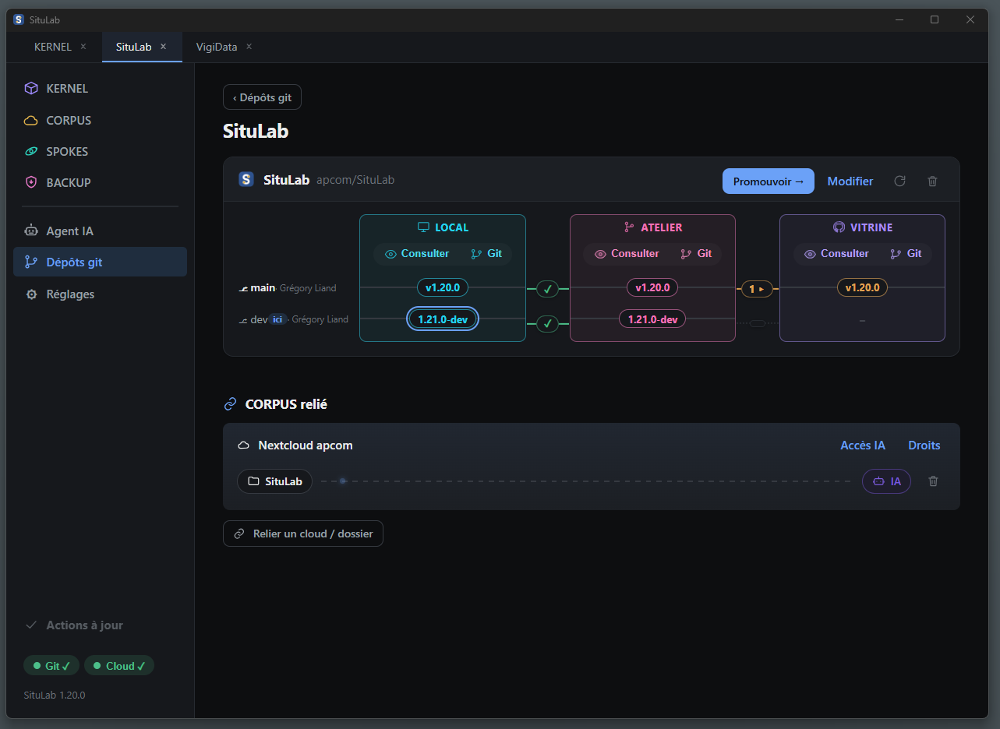
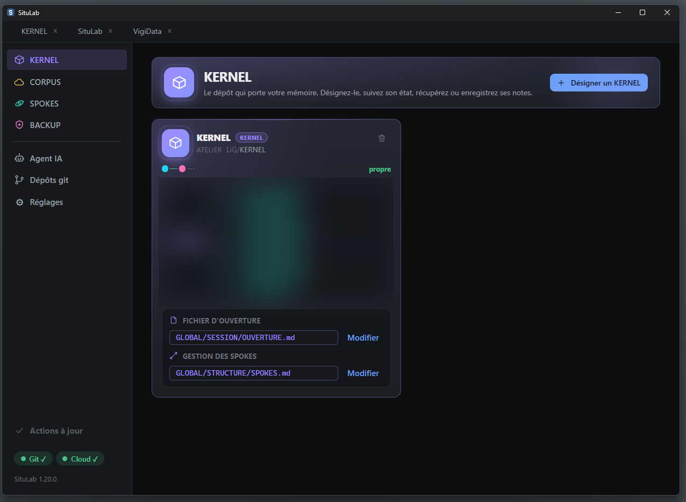
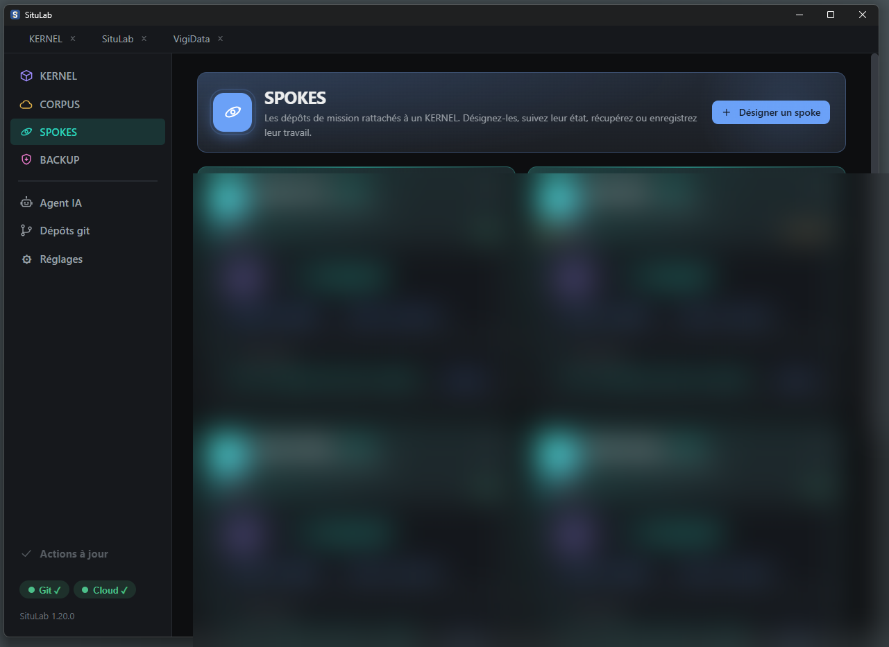
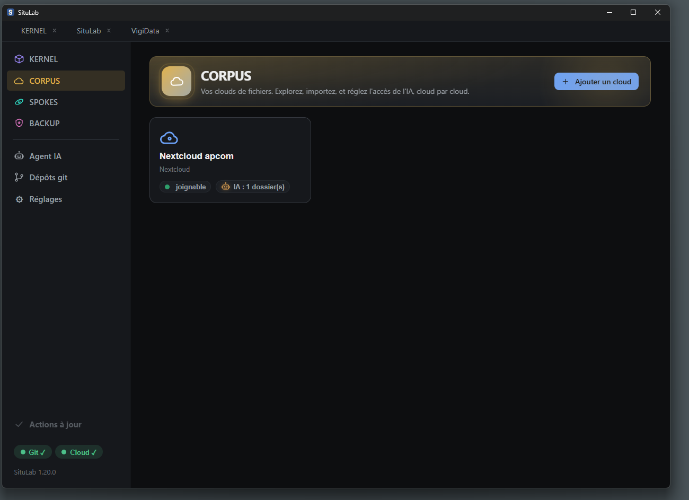
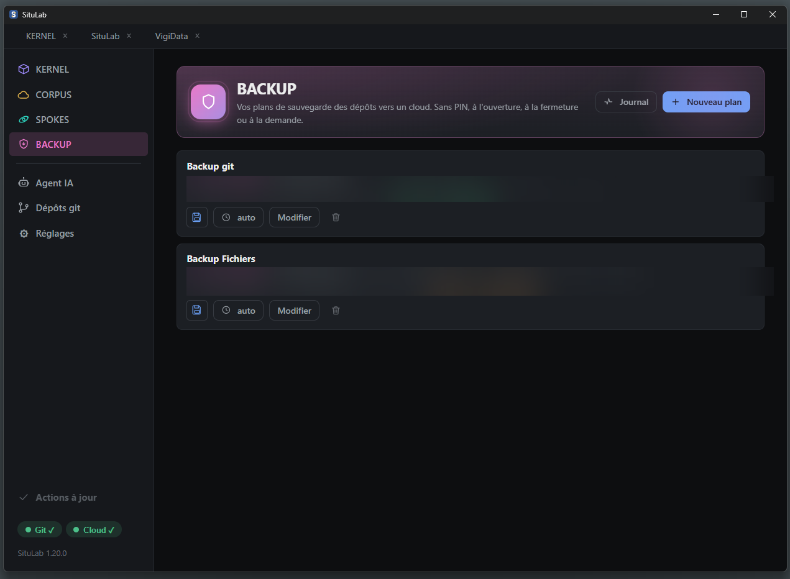
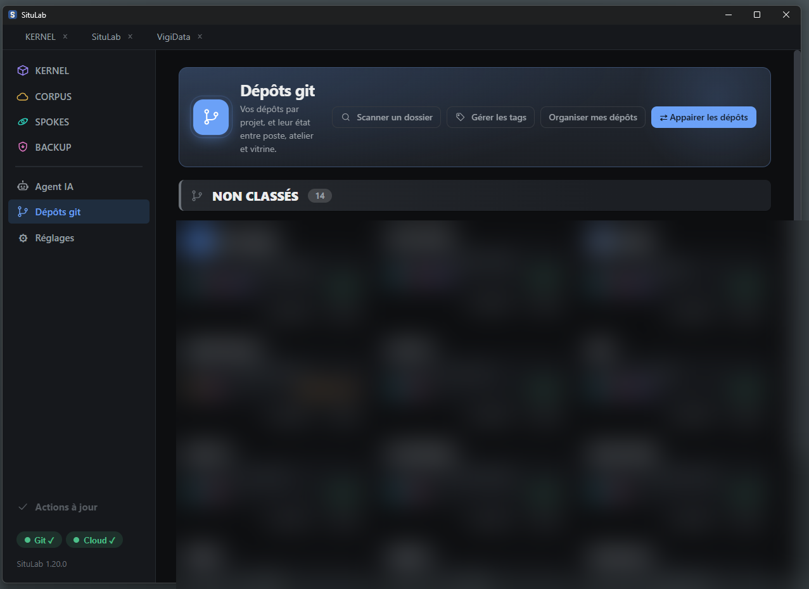
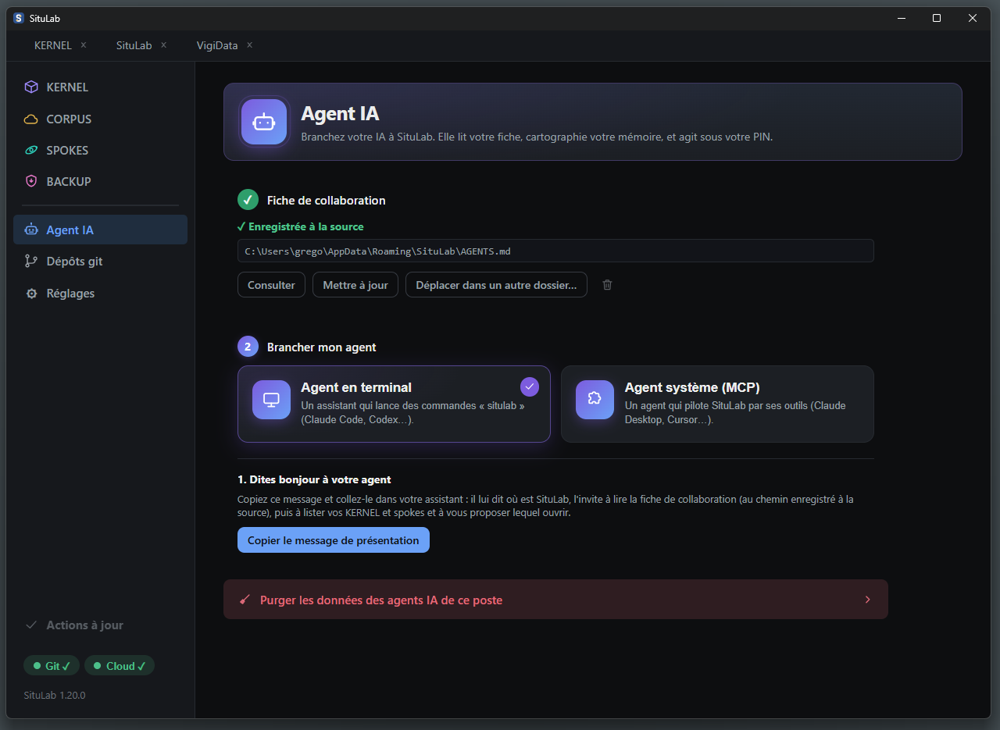

# SituLab

[](https://github.com/Apcom-Solutions-SA/situlab/actions/workflows/ci.yml)

**L'utilitaire git et mémoire pour tous.** Une application de bureau, multiplateforme, qui rend lisible
ce que vous avez en ligne et en local, sans navigateur et sans connaître git en profondeur, et qui garde
votre mémoire de travail en ordre, pour vous comme pour vos agents IA.

> © 2026 APCOM Solutions SA — licence Apache 2.0



## Télécharger

Installateurs prêts à l'emploi pour Windows, macOS et Linux sur la
**[page des Releases](https://github.com/Apcom-Solutions-SA/situlab/releases/latest)**.

## Quatre piliers

- **KERNEL** : le dépôt qui *est* votre mémoire, désigné, lisible, synchronisé en deux gestes.
- **SPOKES** : les projections de mission rattachées à un KERNEL.
- **CORPUS** : vos clouds de fichiers souverains (Nextcloud, kDrive), avec un accès IA borné par dossier.
- **BACKUP** : vos sauvegardes des dépôts vers le CORPUS, prêtes à l'emploi.

Autour, l'appairage du clone local, de l'atelier et de la vitrine, et la promotion d'une version validée
(sous PIN, jamais par un push direct).

## Aperçu

<table>
<tr>
<td width="50%"><br><sub><b>KERNEL</b> — le dépôt qui porte votre mémoire, et ses spokes.</sub></td>
<td width="50%"><br><sub><b>SPOKES</b> — les projections de mission rattachées à un KERNEL.</sub></td>
</tr>
<tr>
<td><br><sub><b>CORPUS</b> — vos clouds souverains, accès IA borné par dossier.</sub></td>
<td><br><sub><b>BACKUP</b> — sauvegardes des dépôts vers un cloud.</sub></td>
</tr>
<tr>
<td><br><sub><b>Dépôts git</b> — l'état poste / atelier / vitrine de chaque dépôt.</sub></td>
<td><br><sub><b>Agent IA</b> — brancher un assistant, qui agit sous votre PIN.</sub></td>
</tr>
</table>

> Certaines zones (noms de dépôts internes, chemins de sauvegarde) sont volontairement floutées.

## Idée

Vous connectez une ou plusieurs instances Forgejo/Gitea ou GitHub, et vos clouds souverains. SituLab vous
montre alors, selon vos droits, vos dépôts et vos fichiers, et pilote les opérations git locales comme les
gestes cloud. Simple pour l'humain, pilotable par script pour les agents IA.

Pour Forgejo, la première connexion crée elle-même un jeton à partir de vos identifiants. Pour GitHub, vous
collez un jeton d'accès personnel, car GitHub ne permet pas à une application de le créer.

## Trois accès, un seul noyau

- **Fenêtre graphique** (humain) : application de bureau native.
- **Ligne de commande** `situlab` (agents en shell).
- **Serveur MCP** `situlab mcp` (agents sans terminal, comme Cursor ou Claude Desktop).

Un seul binaire : sans argument il ouvre la fenêtre, avec une commande il agit en mode agent. Les trois
accès partagent le même noyau et le même point de consentement PIN. Les réglages (rôles, politique PIN,
projets) restent réservés à la fenêtre.

```
situlab                         # ouvre la fenêtre
situlab repo list --output json # mode agent (CLI)
situlab mcp                     # serveur MCP (stdio)
```

## Sécurité

Jetons chiffrés par votre PIN, jamais stocké et jamais transmis à l'agent. Toute écriture distante demande
le PIN dans une fenêtre, sur le poste. Détail et limites assumées dans [`SECURITY.md`](SECURITY.md).

## Pilotage par un agent IA

Toute la surface est documentée pour une IA, qui prépare les actions pendant que l'humain valide les
écritures par son PIN : voir [`docs/AGENTS.md`](docs/AGENTS.md).

## Prérequis

- **git** installé, car SituLab pilote le git du système au lieu de le réimplémenter.
- Windows : WebView2, présent par défaut sur Windows 11.

## Construire depuis les sources

Go (directive `go.mod`) et Wails v2. Binaire console, nécessaire pour un mode CLI fiable :

```bash
go build -tags "desktop,production" -o build/bin/situlab.exe .
```

Les installateurs Windows, macOS et Linux sont produits par intégration continue
(`.github/workflows/release.yml`) sur un tag `v*`. Chaque OS a sa toolchain native, ils ne se
cross-compilent pas.

## Développement & qualité

Le dépôt applique les mêmes portes que l'intégration continue (`.github/workflows/ci.yml`), toutes
bloquantes :

```bash
gofmt -l .            # format (zéro écart)
go vet ./...          # analyse statique
golangci-lint run     # lint (jeu standard, config v2)
go test -race ./...   # tests, détecteur de courses (matrice Linux/Windows/macOS en CI)
govulncheck ./...     # vulnérabilités des dépendances
```

## Contribuer

Les contributions sont bienvenues. Lisez [`CONTRIBUTING.md`](CONTRIBUTING.md) pour le flux de travail et
les portes de qualité, et le [`CODE_OF_CONDUCT.md`](CODE_OF_CONDUCT.md). Une vulnérabilité se signale en
privé, jamais en issue publique : voir [`SECURITY.md`](SECURITY.md).

## Licence

Logiciel libre sous licence Apache 2.0 : voir [`LICENSE`](LICENSE) et [`NOTICE`](NOTICE). « SituLab » et
le logo sont des marques d'APCOM Solutions SA, non couvertes par la licence (section 6, « Trademarks »).

---

© 2026 APCOM Solutions SA — sous licence Apache 2.0.
